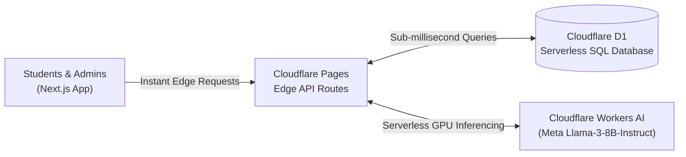

# Technology Architecture & Pitch Deck Summary

> **One-Liner Elevator Pitch:**  
> *"An ultra-fast, serverless campus grievance platform built on Cloudflare's Edge network that turns student complaints into prioritized, executive AI briefings in seconds—at practically zero operational cost."*

---

## 1. High-Level Architecture Diagram

---

## 2. Slide-Ready Pitch Pillars (For Presentation Slides)

### Slide Title: **Modern, Serverless & Intelligent Architecture**

#### 1. Zero Cold Starts & Global Edge Delivery (Next.js Edge API)
- **What it is:** The application backend runs on Cloudflare's global edge network (over 300+ cities worldwide, including India), not on a slow centralized server.
- **Why it matters:** Instant page loads, zero server sleep time, and 100% uptime even during peak campus election or exam periods.

#### 2. Sub-Millisecond Database at the Edge (Cloudflare D1)
- **What it is:** A distributed, serverless relational SQLite database running alongside our compute logic.
- **Why it matters:** Unlike legacy college portals that crash under traffic spikes, D1 provides ACID-compliant transactions with sub-10ms response times and automatic replication.

#### 3. Native On-Demand AI Intelligence (Cloudflare Workers AI)
- **What it is:** Enterprise-grade LLM inference (`@cf/meta/llama-3-8b-instruct`) executed directly on Cloudflare's serverless GPU infrastructure.
- **Why it matters:** No external third-party API keys (like OpenAI), no risk of student data leaking to unauthorized LLM aggregators, and instant 2-paragraph administrative synthesis generated in under 3 seconds.

#### 4. Near-Zero Operational Cost (Hyper-Efficient Serverless)
- **What it is:** Pure pay-as-you-go serverless architecture with generous free tiers across compute, database, and AI.
- **Why it matters:** The college pays **\$0 in fixed hosting fees**. No monthly virtual machine rentals, no DevOps maintenance overhead, and infinite autoscaling.

---

## 3. Comparison Table: Legacy College Portals vs. Our Platform

| Feature | Legacy College Helpdesk | Our Cloudflare Edge Platform |
|---|---|---|
| **Architecture** | Monolithic server (EC2 / Local VM) | Distributed Serverless Edge |
| **Response Latency** | 500ms – 2,000ms | **Sub-50ms** |
| **Database** | Heavy centralized MySQL/Postgres | **Cloudflare D1 (Edge SQLite)** |
| **Campus Analytics** | Manual spreadsheets & email backlogs | **Workers AI Executive Briefing (Llama 3)** |
| **Scalability** | Crashes during peak rush hours | **Automatic infinite elasticity** |
| **Server Maintenance** | High IT maintenance & patch cycles | **Zero server management** |
